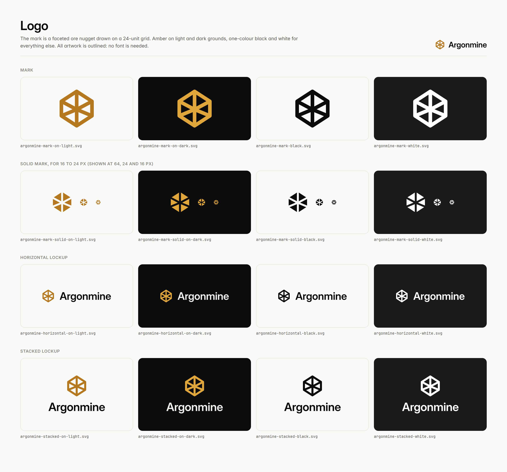
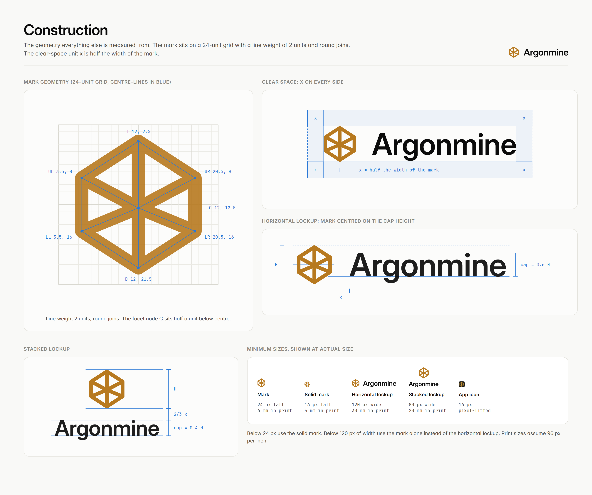
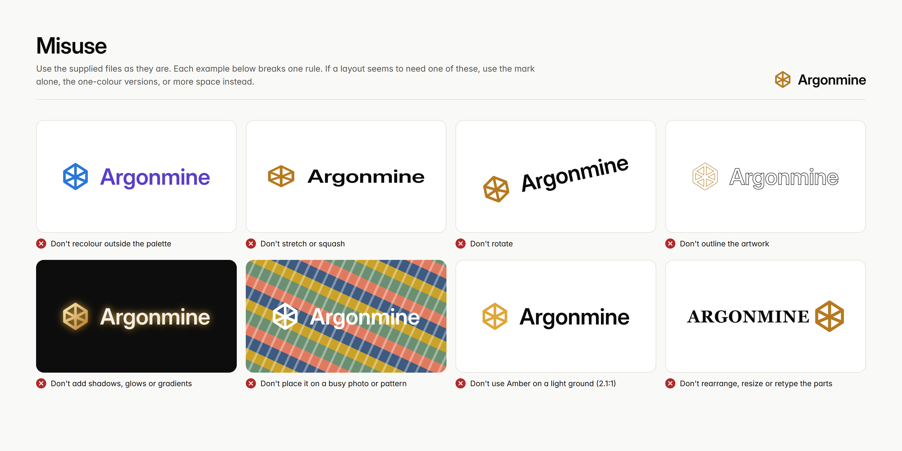
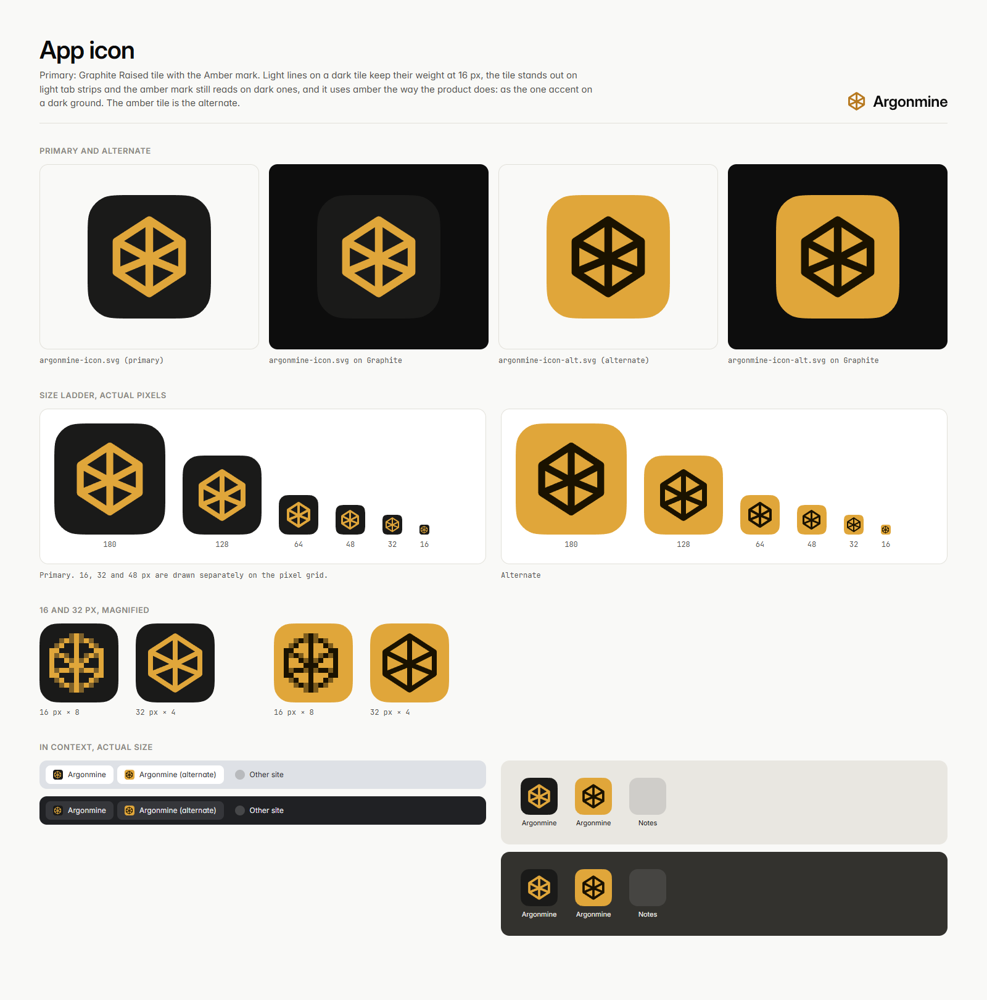
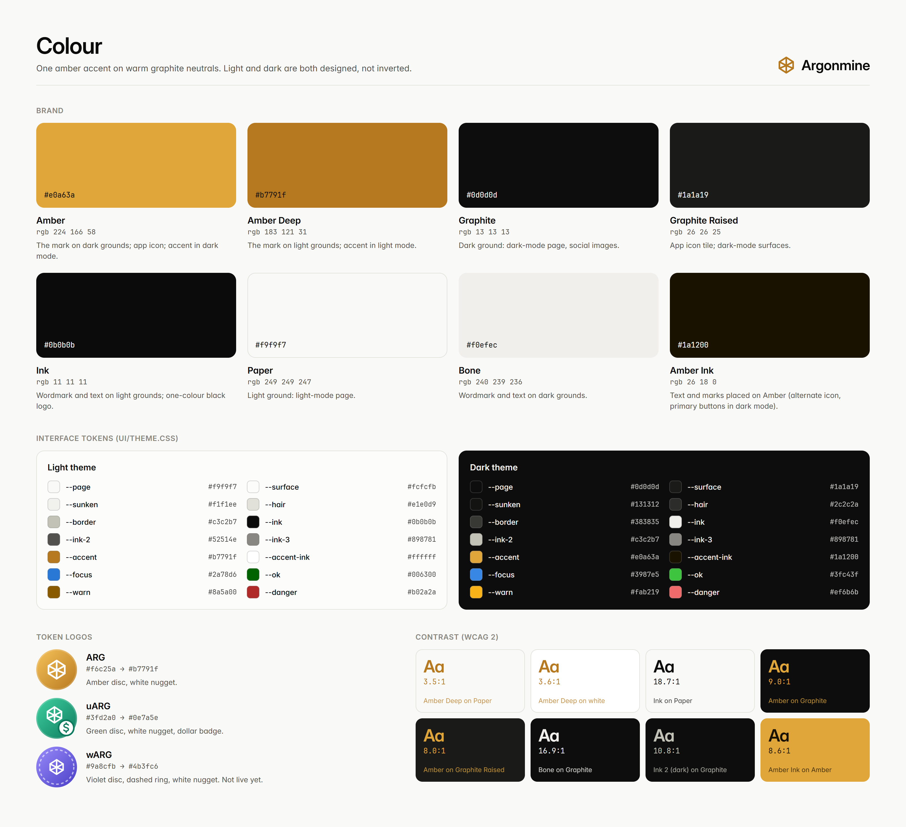
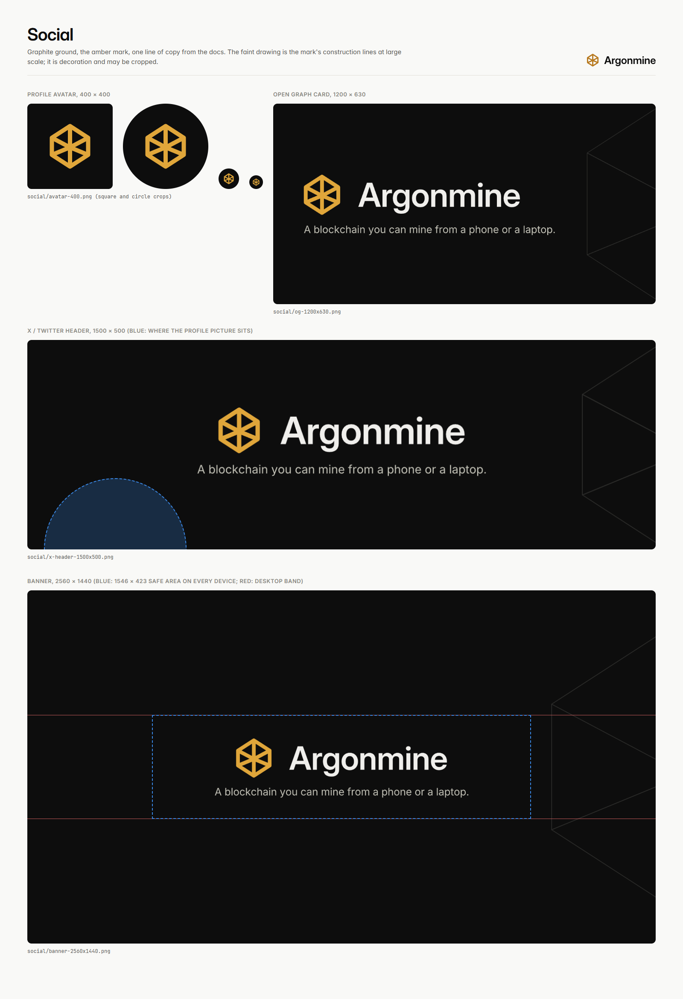

# Argonmine brand kit

Argonmine is a proof-of-work blockchain whose coin, ARG, can be mined from a
phone or a laptop browser. This kit holds the logo, app icon, colours, social
images and the rules for using them. Everything here is drawn from the
product itself: the mark is the one in `ui/ui.go`, the colours are the ones in
`ui/theme.css`, the type is the interface's own.



## Logo

### Anatomy

**The mark** is a faceted ore nugget: a hexagon on a 24-unit grid, split into
six facets that meet at a node half a unit below centre. The centre-line
vertices are T 12,2.5 · UR 20.5,8 · LR 20.5,16 · B 12,21.5 · LL 3.5,16 ·
UL 3.5,8 · node C 12,12.5. The line weight is 2 units with round joins, which matches the stem weight of the
wordmark. The interface glyph in `ui/ui.go` is the same drawing at the same
weight.

**The solid mark** is the line mark's negative: the same geometry with the
facet lines cut out as 2-unit gaps. It keeps its shape where thin lines
would fill in. Use it from 16 to 24 px; above that use the line mark.

**The wordmark** is "Argonmine" in Inter Display SemiBold (600), tracked
-0.01 em, with one optical kern (r to g, -0.012 em). It is outlined in every
file: no font is needed and it must never be retyped.

**Lockups.** Horizontal (mark left of the wordmark) is the default. Stacked
(mark above the wordmark) is for square and narrow spaces.



### Proportions

| | Horizontal | Stacked |
|---|---|---|
| Wordmark cap height | 0.6 × mark height | 0.4 × mark height |
| Gap between mark and wordmark | x | ⅔ x |
| Alignment | mark centred on the cap height | mark centred over the wordmark |

The descender of the g ends inside the height of the mark, so the horizontal
lockup is exactly as tall as its mark.

### Clear space

**x = half the width of the mark** (9.5 of the 24 grid units). Keep at least
x clear on every side of the mark and of both lockups, measured from the
edge of the artwork. Nothing goes inside it: no text, no rules, no image
edges, no other logos. The files are trimmed to the artwork, so add the clear
space when you place them.

Quick conversions: for the mark, x = 0.5 × its width; for the horizontal
lockup, x = 0.45 × its height; for the stacked lockup, x = 0.25 × its height.

### Minimum sizes

| Artwork | Screen | Print |
|---|---|---|
| Mark | 24 px tall | 6 mm tall |
| Solid mark | 16 px tall | 4 mm tall |
| Horizontal lockup | 120 px wide | 30 mm wide |
| Stacked lockup | 80 px wide | 20 mm wide |
| App icon | 16 px (use the pixel-fitted 16, 32 and 48 px files) | not for print |

Below 24 px use the solid mark. Below 120 px of width use the mark alone
instead of the horizontal lockup.

### Colour versions

| File suffix | Mark | Wordmark | Use on |
|---|---|---|---|
| `-on-light` | Amber Deep `#b7791f` | Ink `#0b0b0b` | Paper, white and other light grounds |
| `-on-dark` | Amber `#e0a63a` | Bone `#f0efec` | Graphite and other dark grounds |
| `-black` | Ink `#0b0b0b` | Ink | one-colour print, stamps, light grounds where amber is not available |
| `-white` | White `#ffffff` | White | one-colour on dark or coloured grounds, and on photos with a calm, dark area |

### Approved combinations and contrast

WCAG 2 contrast ratios. Logos and icons need at least 3:1; text needs 4.5:1
(3:1 for large or bold text).

| Combination | Ratio | Use |
|---|---|---|
| Amber Deep on Paper | 3.45:1 | the mark on light grounds (graphics only, never body text) |
| Amber Deep on white | 3.64:1 | the mark on white |
| Ink on Paper | 18.67:1 | wordmark and text on light |
| Amber on Graphite | 8.96:1 | the mark and accents on dark |
| Amber on Graphite Raised | 8.03:1 | the app icon |
| Bone on Graphite | 16.90:1 | wordmark and text on dark |
| Ink 2 (dark) `#c3c2b7` on Graphite | 10.85:1 | secondary text on dark, the social tagline |
| Amber Ink on Amber | 8.57:1 | the alternate icon; dark-mode primary buttons |
| Amber Ink on Amber Deep | 5.10:1 | light-mode primary buttons |
| Amber Text `#946016` on Paper | 5.05:1 | links and amber text on light grounds (4.71:1 on Sunken) |
| White on Amber Deep | 3.64:1 | **not for text**: use Amber Ink on amber fills |
| Amber on Paper | 2.06:1 | **not allowed**: use Amber Deep on light grounds |
| Amber Deep on Graphite | 5.34:1 | avoid: use Amber on dark grounds |

### Don't



- Don't recolour the logo outside this palette, or use Amber on a light ground.
- Don't stretch, squash, skew or rotate it.
- Don't outline it, or add shadows, glows, bevels, gradients or textures.
- Don't put it on busy photos or patterns; if a photo is unavoidable, use the
  white version on a calm, dark area of it.
- Don't rearrange, resize or retype the parts of a lockup, or build new
  lockups with other words.
- Don't crowd it: keep the clear space.

## App icon



**Primary: Graphite Raised tile `#1a1a19` with the Amber mark `#e0a63a`.**
Light lines on a dark tile keep their weight at 16 px (dark lines on amber
look thinner at that size), the tile stands out on light tab strips while the
amber mark still reads on dark ones, and it uses amber the way the product
does: as the one accent on a dark ground. The alternate, an Amber tile with
an Amber Ink mark, is for places that need a bright tile, such as a dark
store listing.

The tile is a continuous-curvature rounded square (corner radius 22.4 % of
the side, 60 % smoothing). The mark is 0.656 of the tile's height, which puts
every vertex on whole pixels at 64, 128, 256, 512 and 1024 px. The 16, 32 and
48 px icons are drawn separately on the pixel grid (`icon/small/`); the 16 px
one is hand-hinted.

| File | Use |
|---|---|
| `icon/favicon.ico` | 16, 32 and 48 px in one file, for browsers and Windows |
| `icon/favicon.svg` | the 32 px drawing as a vector favicon for modern browsers |
| `icon/apple-touch-icon.png` | 180 px, full bleed (iOS rounds the corners itself) |
| `icon/png/argonmine-icon-<size>.png` | 1024, 512, 256, 192, 180, 128, 64, 48, 32, 16 px, rounded, transparent corners |
| `icon/png/argonmine-icon-maskable-512.png` | full-bleed 512 px for Android adaptive icons and web manifests (`"purpose": "maskable"`) |
| `icon/argonmine-icon-full-bleed.svg` | square master for platforms that apply their own mask (App Store, Play Store) |

```html
<link rel="icon" href="/favicon.ico" sizes="48x48">
<link rel="icon" href="/favicon.svg" type="image/svg+xml">
<link rel="apple-touch-icon" href="/apple-touch-icon.png">
```

## Colour



One amber accent on warm graphite neutrals. Light and dark are both designed,
not inverted. `colors/colors.css` and `colors/colors.json` carry the brand
colours, the token-logo colours and the full light and dark interface tokens,
identical to `ui/theme.css`.

| Name | Hex | Use |
|---|---|---|
| Amber | `#e0a63a` | the mark on dark grounds; the app icon; accent in dark mode |
| Amber Deep | `#b7791f` | the mark on light grounds; accent in light mode |
| Graphite | `#0d0d0d` | dark ground: dark-mode page, social images |
| Graphite Raised | `#1a1a19` | app icon tile; dark-mode surfaces |
| Ink | `#0b0b0b` | wordmark and text on light; the one-colour black logo |
| Paper | `#f9f9f7` | light ground: light-mode page |
| Bone | `#f0efec` | wordmark and text on dark |
| Amber Ink | `#1a1200` | marks and text placed on Amber |

Status colours (ok, warn, danger, focus) are for interface states only. They
always travel with an icon or a label and never appear in brand artwork.
Colours are specified for screens (sRGB); for print, match the swatches by
eye on the chosen stock.

## Typography

Both families are free under the SIL Open Font License 1.1.

- **Inter** for everything in the interface and in brand layouts:
  [rsms.me/inter](https://rsms.me/inter/), [Google Fonts](https://fonts.google.com/specimen/Inter).
  The wordmark is drawn from Inter Display SemiBold.
- **JetBrains Mono** for numbers that are read digit by digit: amounts,
  addresses, hashes, heights:
  [jetbrains.com/lp/mono](https://www.jetbrains.com/lp/mono/), [Google Fonts](https://fonts.google.com/specimen/JetBrains+Mono).

| Role | Size | Weight | Tracking |
|---|---|---|---|
| Hero number | 40 px | 600 | -0.02 em |
| Page title, stat value | 28 px | 600 | -0.02 em |
| Heading (h1) | 20 px | 600 | -0.01 em |
| Subheading (h2), top-bar title, in-app wordmark | 16 px | 600 (wordmark 650) | -0.01 em |
| Body, card titles | 14 px | 400 (titles 600) | 0 |
| Buttons | 13 px | 600 | 0 |
| Labels | 12 px | 500 | +0.01 em |
| Fine print | 11 px | 400 | 0 |

Line height is 1.5 for text and 1.25 for headings, on a 4 px spacing grid.
Amounts use tabular figures. Write the name in running text in the
surrounding typeface; the outlined wordmark is only for logo use.

## Token logos

`tokens/arg.svg`, `tokens/uarg.svg`, `tokens/warg.svg`, with PNGs at 64, 128,
256 and 512 px in `tokens/png/`.

| Token | Logo | What it is |
|---|---|---|
| ARG | amber disc, white nugget | the coin; only ever created by mining |
| uARG | green disc, white nugget, dollar badge | a dollar token: 1 uARG = $1, backed one to one by USDC and USDT held in the bridge vaults |
| wARG | violet disc, dashed ring, white nugget | wrapped ARG, one to one. **Not live yet**: show it only where plans are described, and label it "planned" |

- Use a token logo only to mean that token, always with its ticker next to
  it, never as the Argonmine logo.
- Minimum size 20 px. Below that, show the ticker alone.
- Keep the discs as supplied: no rings, glows or recolouring, and don't set
  one token's glyph on another token's disc.

## Social



Graphite ground, the Amber mark, and at most one line of copy besides the
name. The faint drawing is the mark's own construction lines at large scale;
it is decoration and may be cropped.

| File | Size | Notes |
|---|---|---|
| `social/avatar-400.png` | 400 × 400 | mark only; survives a circle crop |
| `social/og-1200x630.png` | 1200 × 630 | link previews (`og:image`, `twitter:image`) |
| `social/x-header-1500x500.png` | 1500 × 500 | content centred; the bottom-left is left clear for the profile picture |
| `social/banner-2560x1440.png` | 2560 × 1440 | YouTube and wide banners; everything that matters sits in the central 1546 × 423 safe area |

Editable, fully outlined sources are in `social/src/`. The images describe
the brand, not the state of the network, so they never say "testnet".

## Voice and wording

Short, plain and honest. Say what the thing does, in the words the docs use.

Approved lines:

- "A blockchain you can mine from a phone or a laptop." (the social tagline)
- "Argonmine is a proof-of-work blockchain whose coin, ARG, can be mined
  from a phone or a laptop browser." (the one-sentence description)
- "Every coin is mined. There is no premine; from block 300, 1% of each
  block reward funds the project treasury."

Rules:

- **Say "testnet" wherever test coins appear**: screenshots, balances,
  explorer links, faucet text, posts. Testnet coins have no value, so say so.
- **Never call ARG or uARG an investment.** No prices, predictions, returns,
  yields or APY; no "early", "guaranteed", "to the moon".
- **uARG** is "worth one dollar, backed one to one by USDC and USDT held in
  the bridge vaults". Where deposits or withdrawals come up, mention the 1
  percent bridge fee each way.
- **wARG** is "planned"; never present it as available.
- No hype words: revolutionary, game-changing, next-generation, the future of
  anything.
- Names: **Argonmine** (one word, capital A only; not ArgonMine, ARGONMINE or
  Argon Mine), **ARG**, **uARG** (lower-case u), **wARG** (lower-case w).
  Write amounts with the unit after the number: "50 ARG".
- Spelling follows the docs: British (colour, organise).

## File index

```
brand/
  README.md                         these guidelines
  argonmine-brand-kit.zip           everything below in one archive
  logo/
    argonmine-mark-{on-light,on-dark,black,white}.svg
    argonmine-mark-solid-{on-light,on-dark,black,white}.svg      16 to 24 px
    argonmine-horizontal-{on-light,on-dark,black,white}.svg      default lockup
    argonmine-stacked-{on-light,on-dark,black,white}.svg
    png/<name>-512.png, <name>-1024.png                          transparent, by width
  icon/
    argonmine-icon.svg              primary app icon (Graphite Raised tile, Amber mark)
    argonmine-icon-alt.svg          alternate (Amber tile, Amber Ink mark)
    argonmine-icon-full-bleed.svg, argonmine-icon-alt-full-bleed.svg   square masters
    small/argonmine-icon{,-alt}-{16,32,48}.svg                 pixel-fitted drawings
    png/argonmine-icon-{1024,512,256,192,180,128,64,48,32,16}.png
    png/argonmine-icon-alt-{1024,512,256}.png
    png/argonmine-icon-maskable-512.png
    apple-touch-icon.png, favicon.ico, favicon.svg
  tokens/
    arg.svg, uarg.svg, warg.svg
    png/{arg,uarg,warg}-{64,128,256,512}.png
  social/
    avatar-400.png, og-1200x630.png, x-header-1500x500.png, banner-2560x1440.png
    src/*.svg                       outlined sources
  colors/
    colors.css, colors.json, palette.png
  previews/
    logo-sheet.png, icon-sheet.png, construction.png, misuse.png, social-sheet.png
```

All SVGs are plain paths with a viewBox: no embedded images, fonts or editor
metadata. The wordmark and taglines were outlined from Inter 4.1
(github.com/rsms/inter, SIL OFL 1.1).
